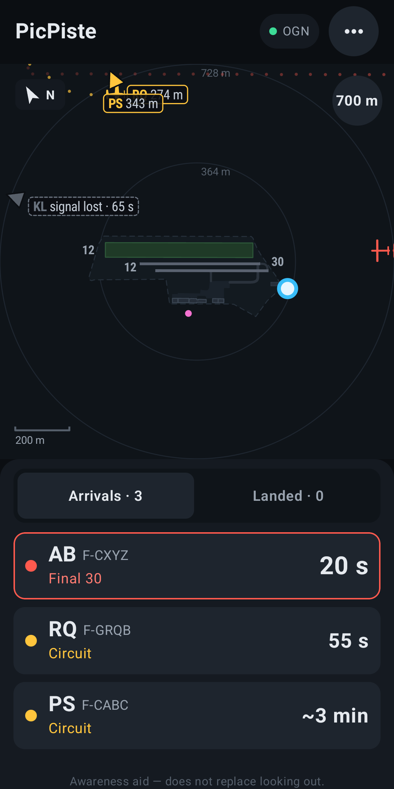
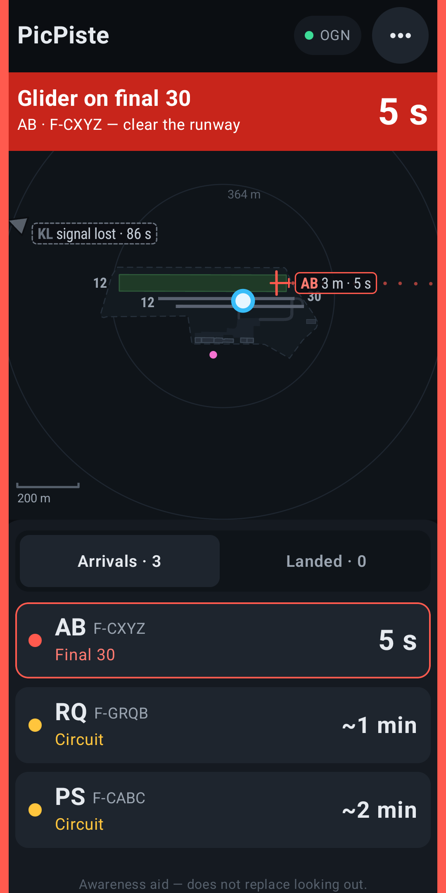

# PicPiste

**The glider radar for the club's golf cart.**

PicPiste shows live where the gliders are around the airfield, who is about to land and
where, and warns the golf-cart driver when they are on a runway while a glider is coming in.
On the cart's Android Auto screen, or simply on the phone.

  
  &nbsp;
  

> PicPiste is an **awareness aid**, not an air traffic control tool.
> Looking outside remains the rule.

## What PicPiste does

- **Live radar**: every glider, tow plane and other FLARM-equipped aircraft around the
  airfield, updated every few seconds.
- **Status of each glider**: takeoff, on tow, flying, circuit, final, landed. You know who
  is coming and how soon.
- **Who landed where**: tap a landed glider to see it on the radar and pick it up at the
  right spot.
- **Runway alert**: if the cart is on a runway while a glider is on final, in the circuit or
  taking off, a sound and a red banner warn you ("Glider on final 30, 40 s"). Few alerts,
  so alerts people listen to.
- **Any airfield**: pick your airfield by its ICAO code, adjust runways and buildings on the
  map (or on site with the GPS), then share it with the other drivers.
- **Automatic day / night mode**, in **English or French** following the phone's language.
- **Privacy**: aircraft that asked not to be tracked are not shown; those that asked for
  anonymity are shown without a name.

Data comes from the **OGN (Open Glider Network)**, which relays the FLARM positions of
aircraft. You need an OGN receiver near the airfield to see gliders down to the ground, and
an internet connection (4G) on the phone.

## Install

There are two versions, signed with the same key, so one installs over the other:

| | Phone app | Android Auto |
|---|:---:|:---:|
| **GitHub** (APK, below) | ✓ | ✓ |
| **Google Play** (coming soon) | ✓ | — |

Google does not accept PicPiste's Android Auto screen on the Play Store: it draws its own
radar, which Google only allows for turn-by-turn navigation apps. The Play version is the
phone app alone. Installing it over the GitHub version removes Android Auto.

### With Obtainium (recommended)

[Obtainium](https://github.com/ImranR98/Obtainium) installs PicPiste from the GitHub releases
and keeps it up to date.

### By hand

1. Download the latest `PicPiste-x.y.apk` from the
   [Releases](https://github.com/CorentinGrard/PicPiste/releases).
2. Open it on the Android phone and allow installing from unknown sources.
3. Updates install the same way, over the previous version.

## Enable PicPiste in Android Auto

Android Auto only shows apps it believes came from Google Play. During a car session it asks
the Play Store where each app was installed from, and hides the others. The phone app works
without any of this; pick one of these options for the car screen:

1. **Android Auto's "Unknown sources"** (simplest, but not accepted by every car or Android
   Auto version). On the phone: Android Auto → Settings → tap **Version** 10 times → ⋮ menu
   → Developer settings → tick **Unknown sources**.
2. **Install through Obtainium as if from Google Play.** Install
   [Shizuku](https://shizuku.rikka.app/), then in Obtainium's settings turn on **Use Shizuku
   to install** and **Pretend to be Google Play**, and (re)install PicPiste. Updates keep
   working the same way.
3. **[UnknownAuto](https://github.com/GitMag/UnknownAuto)**: a free, open-source tool that
   makes Android Auto accept apps installed from outside the Play Store, with only the phone.
   A closed-source alternative is AA Enabler.

Then plug the phone into the cart: PicPiste shows up in the Android Auto launcher. If it
does not, see the notes in [docs/DEVELOPMENT.md](docs/DEVELOPMENT.md).

These tools are third-party projects, not part of PicPiste. Google is also tightening
sideloading rules from late 2026, so options may change.

## Getting started

1. **Pick the airfield**: on first launch, enter the ICAO code (e.g. LFNL, LFLE) or open an
   airfield file sent by another driver.
2. **Check the airfield**: Settings (⋯) → Airfield → **Edit**. Tap a runway, a threshold or
   a hangar to select it and drag its points. On site, drive to the point and tap **Put
   this point here**. Then **Save**.
3. **Share the airfield**: in the editor, ⋯ → **Share** sends a `PicPiste-XXXX.json` file.
   The other driver opens it with PicPiste, checks it, then saves.

## For developers

Building, tests, CI and signing key: [docs/DEVELOPMENT.md](docs/DEVELOPMENT.md).
Design rules (statuses, alerts, what is shown): [docs/DESIGN.md](docs/DESIGN.md).
Open points: [GitHub issues](https://github.com/CorentinGrard/PicPiste/issues).

## License and data

PicPiste is free software under the **GNU GPL v3** ([LICENSE](LICENSE)): you may use, study,
modify and redistribute it, provided you publish your changes under the same license. It
comes with no warranty: it is an awareness aid and does not replace looking outside.

Data used:

- **Aircraft positions**: [Open Glider Network](https://www.glidernet.org), under the ODbL,
  following the [OGN data usage rules](https://www.glidernet.org/ogn-data-usage/) (privacy
  choices in the database respected, no data redistributed).
- **Aircraft names**: [OGN device database](https://ddb.glidernet.org), under the ODC-BY.
  A copy ships with the app and is updated daily.
- **Airfields**: © [OpenStreetMap](https://www.openstreetmap.org/copyright) contributors,
  under the ODbL.
- **Airfield elevation**: [Open-Meteo](https://open-meteo.com).
- **Editor base maps**: aerial photos © IGN, map © OpenStreetMap.
